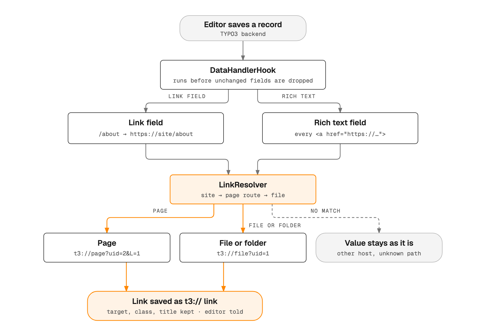

# TYPO3 Extension `link_alchemy`

## What does it do?

The `link_alchemy` extension transforms URLs like `domain.tld/services` to TYPO3 links (`t3://page...`,
`t3://file...`, `t3://folder...`) if those are actually internal links. It does this when a record is saved,
in TCA `type=link` fields and in rich text fields.

## How it works

On every save, the extension sends each absolute link to the link resolver and keeps only the links it can turn
into a page, file or folder.



## Installation and configuration

To install the extension, use Composer:

```bash
composer require plan2net/link-alchemy
```

No configuration is required.

## Compatibility

Versions 12.0.0 and higher are compatible with the corresponding TYPO3 versions.

## Usage

Save a record. Links in link fields and in rich text that point to a page, file or folder of one of your sites
are rewritten, and the editor sees a message about each change. Target, class and title of a link field stay as
they are. Paths like `/about` in link fields are resolved against the site of the record.

## Example

- **Before**: `<a href="https://example.com/internal-page">Link</a>`
- **After**: `<a href="t3://page?uid=123">Link</a>`

# Acknowledgements

This extension was inspired by [Georg Ringers](https://github.com/georgringer)'s uri2link extension that only
transforms TCA `type=link` fields.
